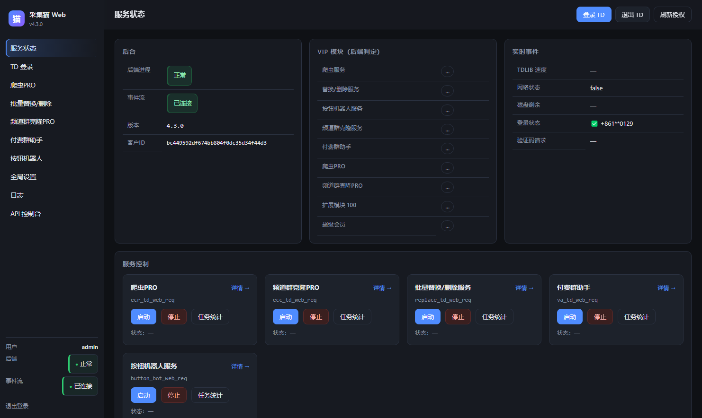
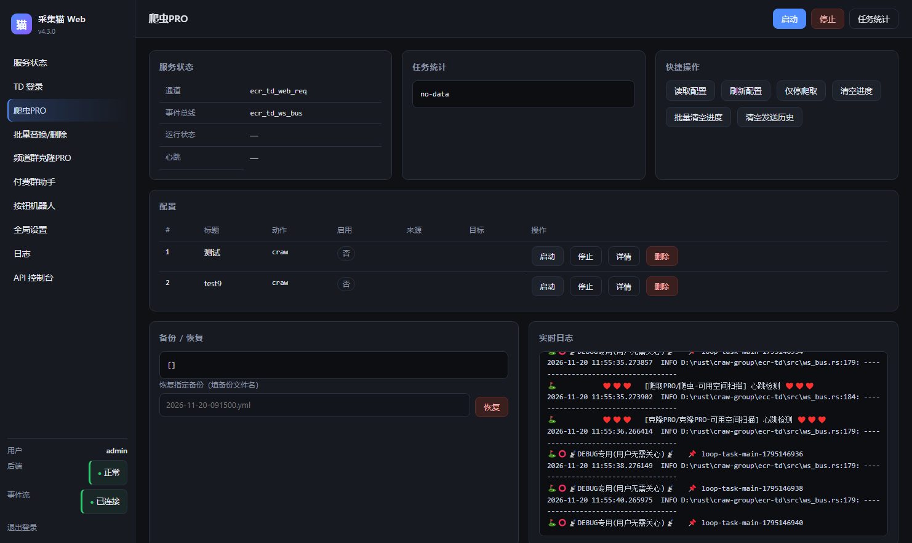
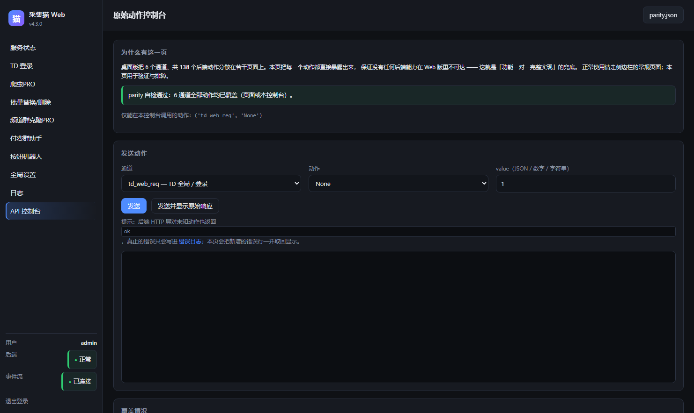
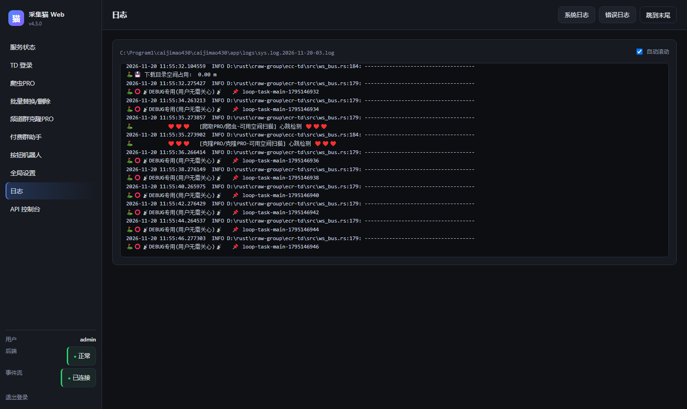

# 采集猫 Web 版（Docker）

把采集猫 4.3.0 桌面版的能力搬到浏览器里：**一条 `docker run`，打开网页，登录后就能用全部功能**。

- 桌面版的业务逻辑一行没改 —— 它本来就是个「Rust 后端 + PySide6 客户端」的结构，桌面客户端只是后端的 HTTP/WebSocket 客户端。
- 所以这里做的事是：**用 Wine 在容器里跑原版后端，用 FastAPI 重写「客户端」这一层**。功能因此天然一一对应，不是"重新实现一遍"。
- 138 个后端动作全部可达，其中 137 个有专门页面/按钮，剩下的 1 个（`td_web_req.None`，占位枚举）在 `/admin/console` 里。`/api/parity` 会实时自检这件事。

> ⚠️ 本项目是**非官方**的第三方重构，与采集猫作者无关。请自行评估使用风险；Telegram 账号安全、代理、以及你抓取内容的合规性由你自己负责。

---

## 截图

| 服务状态 | 爬虫 PRO |
| --- | --- |
|  |  |

| API 控制台（穷尽所有动作） | 日志 |
| --- | --- |
|  |  |

---

## 快速开始

### 1. 用现成镜像

**推荐：一行命令**（没有续行符，复制粘贴不会出错）

```bash
docker run -d --name caijimao-web --restart unless-stopped -p 8080:8080 -e WEB_USER=admin -e WEB_PASSWORD='换成你自己的密码' -e TZ=Asia/Shanghai -v "$PWD/data:/data" --shm-size=512m ghcr.io/wolf575/caijimao-web:4.3.0
```

拉镜像（`docker run` 会自动拉，也可以先手动拉一次）：

```bash
docker pull ghcr.io/wolf575/caijimao-web:4.3.0
```

或者用脚本，密码、端口、数据目录都可以给：

```bash
./scripts/run.sh '换成你自己的密码'
# PORT=18080 DATA_DIR=/srv/cjdata ./scripts/run.sh '换成你自己的密码'
```

或者用 compose（最不容易打错）：

```bash
mkdir -p cj && cd cj
curl -fsSLO https://raw.githubusercontent.com/wolf575/caijimao-web/main/docker/docker-compose.yml
printf 'WEB_PASSWORD=%s\n' '换成你自己的密码' > .env
docker compose up -d
```

> 镜像约 **5.4 GB**（解压后），主要是 Wine 运行时（约 2.2 GB）+ 预初始化的
> Wine prefix（约 1.5 GB）+ 后端载荷（180 MB）。拉取时请留够磁盘和时间。

该镜像由本仓库的 GitHub Actions 从 `docker/Dockerfile` 构建并推送到 GHCR
（见 [`.github/workflows/docker.yml`](.github/workflows/docker.yml)），公开可匿名拉取。
想自己构建就走下面第 2 节，产物与镜像内完全一致。

打开 <http://localhost:8080> → 输入账号密码 → 进入控制台。

`WEB_PASSWORD` 不填时，容器会生成随机密码并**只在日志里打印一次**：

```bash
docker logs caijimao-web | grep -i password
```

#### 启动报错怎么办

`docker: invalid reference format` —— 这是 **shell 把参数切错了**，不是镜像有问题
（`docker pull` 已经成功就说明镜像没问题）。几乎都是多行命令粘贴时续行符 `\`
被吃掉/带上了 `\r`，或者某个 `-e` 的值里有空格没引号。三种解法，任选：

1. 用上面那条**单行**命令；
2. 用 `./scripts/run.sh` 或 compose；
3. 自己拼的话确认每个 `\` 后面**紧跟换行、没有空格**，且含空格的值用单引号包起来。

其它常见情况：

| 现象 | 原因 / 处理 |
|---|---|
| `no matching manifest for linux/arm64` | 镜像只有 `linux/amd64`。arm 机器（Apple Silicon、ARM 云主机）跑不了 Wine + x64 PE |
| `docker ps` 一直 `starting` | 首次要初始化 Wine prefix，给到 120 秒；`docker logs` 能看到 `播种 config.yml` 之后才算正常 |
| 打开页面 502 / 连不上 | 容器没 healthy：`docker logs caijimao-web`，重点看 `启动后端` 之后有没有 `log init 完成` |
| 登录一直转圈不弹验证码 | `ui-proxy.yml` 是空代理列表且服务器直连不到 Telegram。进「TD 登录」页把代理填上（`socks5`/`http` 都行）再重试 |
| 想换端口 | 改 `-p 18080:8080`，容器内固定 8080 |

### 2. 自己构建

```bash
# 拉 payload（后端 exe + DLL）
./scripts/fetch_payload.sh

# ffmpeg 需自己放（体积原因不进 Release）
#   https://www.gyan.dev/ffmpeg/builds/ -> ffmpeg-release-essentials.zip
#   取 bin/ffmpeg.exe 放到 payload/app/ffmpeg.exe

docker build -f docker/Dockerfile -t caijimao-web:4.3.0 .
docker run -d -p 8080:8080 -e WEB_PASSWORD='...' -v "$PWD/data:/data" caijimao-web:4.3.0
```

### 3. docker compose

```bash
cd docker
cp .env.example .env      # 改密码
docker compose up -d
```

---

## 第一次进入后要做的三件事

1. **TD 登录**（左侧「TD 登录」）：填手机号 → 收验证码 → 需要两步验证就再填密码。
   后端会把登录态存在 `/data` 里，之后重启容器自动恢复，**不需要每次重新登录**。
2. **代理**（同一页的「代理配置」）：默认预填了 `127.0.0.1:10808`（http）。
   如果你在容器里没有本地代理，把它改成你的代理地址，或者用 `[]` 清空后靠直连。
   > 采集猫有个坑：`ui-proxy.yml` 为空数组 `[]` 时登录会卡在"正在获取电话号码"之后不动。所以**别把它留成空**，除非你确认直连可用。
3. **功能配置**：每个服务页都有自己的配置表（`GetCfg` / `GetCfgRow` / `StartCfgRows`）。
   注意 `from_chat` / `to_chat` 的 `cid` 必须是**你这个账号真实可见**的会话，否则日志会报
   `Invalid chat identifier specified` 或 `发现id为 0 的 [来源群->0] 已不可用`。

---

## 页面 ↔ 桌面版对照

| 桌面版 | Web 版 | 后端通道 |
| --- | --- | --- |
| 服务状态 / 用户注册信息 | `/` | `td_web_req` |
| TD 登录、代理、会话列表 | `/td-login` | `td_web_req` |
| TD 爬虫服务（爬虫PRO） | `/ecr` | `ecr_td_web_req` |
| 频道群克隆（克隆PRO） | `/ecc` | `ecc_td_web_req` |
| 批量替换/删除服务 | `/replace` | `replace_td_web_req` |
| 付费群助手（媒体加工） | `/va` | `va_td_web_req` |
| 按钮机器人服务 | `/btn-bot` | `button_bot_web_req` |
| 全局设置（编码器/ffmpeg/同步/授权） | `/settings` | `td_web_req` |
| 日志窗口 | `/logs` | 读 `app/logs/*.log` |
| —（桌面版没有） | `/admin/console` | 任意通道任意动作 |

每个服务页都会把该通道**剩余的所有动作**列在「高级动作」里，所以不存在"某个按钮没搬过来"的情况。

---

## 认证与安全

- 单管理员账号，来自 `WEB_USER` / `WEB_PASSWORD`（或 `WEB_PASSWORD_HASH`，bcrypt）。
- 密码用 bcrypt 校验；比较用 `hmac.compare_digest`。
- 会话是 itsdangerous 签名 cookie（`HttpOnly`、`SameSite=Lax`，`CJ_COOKIE_SECURE=1` 时加 `Secure`）。
- 表单和 `/api/*` 都要求 CSRF token（double-submit，token 绑在会话里）。
- 登录失败按 IP 限速：5 次 / 5 分钟。
- `/api/*` 未登录返回 401 JSON，页面未登录 303 跳 `/login`。
- **后端只监听容器内的 `127.0.0.1:3334`，不对外暴露**。对外只有 8080 这一个入口。
- 容器里以 root 跑（Wine 需要写 `WINEPREFIX`）。如果你要加固，可以 `--user` 指定 UID，并把 `/wine`、`/data`、`/app` 的属主改成它。

反向代理（Nginx / Caddy）时记得：SSE 需要关掉响应缓冲。

```nginx
location / {
    proxy_pass http://127.0.0.1:8080;
    proxy_http_version 1.1;
    proxy_set_header Host $host;
    proxy_set_header X-Forwarded-For $proxy_add_x_forwarded_for;
    proxy_buffering off;          # SSE 必须
    proxy_read_timeout 3600s;
}
```

---

## 数据与持久化

**只需要挂一个卷 `/data`**，所有东西都在里面：

```
data/
├── backend.stdout.log     # Wine 下后端的 stdout/stderr
├── webui.log              # Web 控制台日志
├── is_vip.json            # 最后一次收到的 VIP 状态（仅观测用）
├── .web_credentials       # bcrypt 密码哈希（随机生成密码时）
├── .secret_key            # 会话签名密钥
└── app/                   # ← 后端的工作目录（首次启动时从镜像播种）
    ├── crawler2.exe       #   后端本体
    ├── ffmpeg.exe
    ├── config.yml / ver
    ├── lib/               #   依赖 DLL（同时在 app/ 根下有一份，供 Windows 加载器找）
    ├── logs/              #   后端日志（按 UTC 小时滚动）
    ├── sled/              #   键值缓存
    └── data/              #   TDLib 数据库 + 下载缓存 + 登录态
```

后端的工作目录就是它的数据目录，所以 entrypoint 首次启动会把镜像里的 `/app`
播种到 `/data/app`，之后一直从那里跑。**结果是重启容器不用重新登录 Telegram**，
配置和下载缓存也都留下来了。升级镜像时会自动更新 `crawler2.exe` / DLL / `ver`，
保留 `config.yml`、`data/`、`logs/`。

---

## 关于「收费限制」

这个 Web 版跑的是**已解除收费限制**的后端。补丁只有三个字节，改的是三个 VIP 判定函数的返回值：

| VA | 文件偏移 | 原字节 | 补丁后 | 含义 |
| --- | --- | --- | --- | --- |
| `0x1403bfbc0` | `0x3befc0` | `55 41 56` | `B0 00 C3` | 立即返回 0（= 已开通） |
| `0x14099d660` | `0x99ca60` | `55 41 56` | `B0 00 C3` | 立即返回 0（= 已开通） |
| `0x14141a1c0` | `0x14195c0` | `55 41 56` | `B0 01 C3` | 立即返回 1（该调用点语义相反） |

`VA → 文件偏移` 换算：`off = 0x400 + (va - 0x140001000)`。

脚本在 `patch/`：

```bash
python patch/patch4.py  crawler2.exe  crawler2.patched.exe   # 后端三字节补丁
python patch/pyz_patch2.py                                   # 桌面版 UI 文案（可选）
python patch/verify_md5.py                                   # 校验产物
```

> 想还原：Release 里的 `crawler2.exe` 已经是打过补丁的；`patch/patch4.py` 会把原始字节写回。
> 桌面版原始 `ui-crawler.exe` / `caijimao.exe` 未包含在本仓库。

详细逆向过程见 [`patch/PATCH_REPORT.md`](patch/PATCH_REPORT.md)。

---

## 已知限制

- **只支持 `linux/amd64`**。Wine + Windows PE 在 arm64 上跑不通。
- `ffmpeg.exe` 在 Wine 下运行：媒体加工（付费群助手）依赖它。若你的环境里 Wine 跑 ffmpeg 失败，见
  [`docs/ARCHITECTURE.md`](docs/ARCHITECTURE.md) 的「ffmpeg 兜底」一节。
- `IsVip` 只在登录时推送一次，所以「VIP 模块」那栏常常显示 `未推送`。这不影响任何功能。
- 容器内后端与 Web 控制台同生共死：Web 进程退出，容器退出（交给 `restart: unless-stopped` 拉起）；后端崩溃会被 entrypoint 自动重启。
- 端口 3333/3334 是后端写死的，一个容器只能跑一个实例。
- 镜像里 `crawler2.exe` 必须放在**镜像层**（`/app`），不能放到挂载卷里：Docker Desktop 的
  virtiofs 挂载上 `wine` 执行这个 57 MB 的 PE 会直接 `rc=5` 且没有任何输出。详见
  [`docs/ARCHITECTURE.md`](docs/ARCHITECTURE.md)。
- 首次启动要初始化 Wine prefix（约 20 秒）+ 后端读配置，`HEALTHCHECK` 因此给了 120 秒
  `start-period`。这段时间里 `docker ps` 显示 `starting` 是正常的。

## 目录结构

```
.
├── docker/            Dockerfile、entrypoint、compose、.env.example
├── webui/             FastAPI 控制台（parity / backend / auth / wsbridge / app / templates / static）
├── patch/             字节补丁脚本与逆向报告
├── scripts/           fetch_payload.sh、verify_parity.py、shot.py
├── docs/              ARCHITECTURE / API_CONTRACT / PARITY / 截图
└── requirements.txt
```

## 许可

本仓库原创部分 MIT。第三方组件见 [NOTICE.md](NOTICE.md)。
